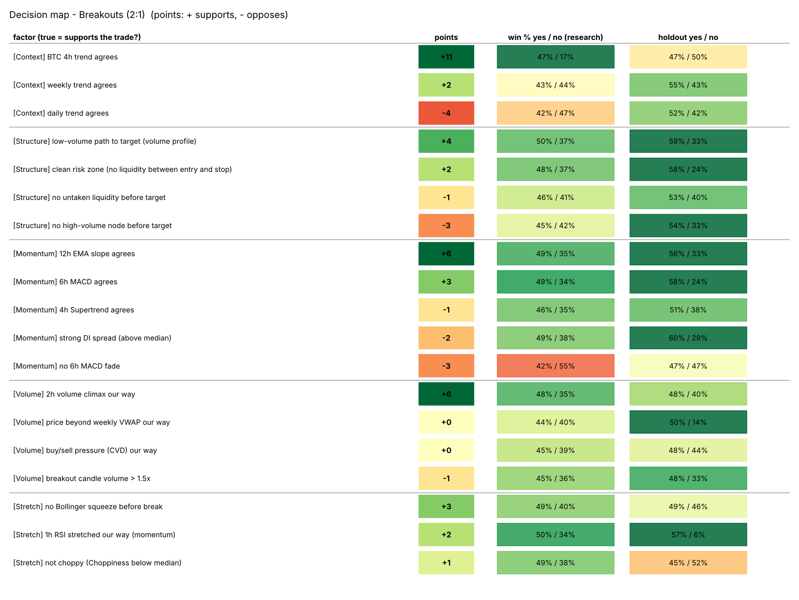
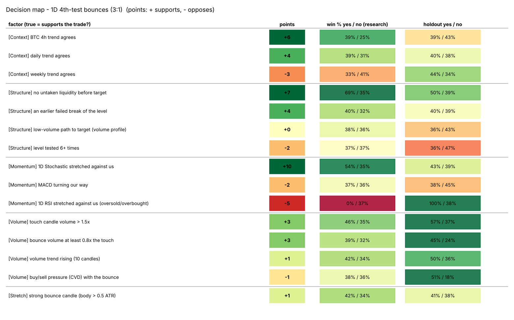

# Decision map: which concepts and indicators support the trade

Each factor is a yes/no question at the entry time. **points** come from fitting all factors together (they share credit, so a factor that only repeats another gets few points). *win % yes / no* = win rate after costs when the factor is true / false. Score = sum of points of the true factors.

## Breakouts (2:1)

| layer | factor | points | how often true | win % if true | win % if false | holdout win % if true | holdout win % if false |
|---|---|---|---|---|---|---|---|
| Context | BTC 4h trend agrees | +11 | 88% | 47% | 17% | 47% | 50% |
| Context | weekly trend agrees | +2 | 60% | 43% | 44% | 55% | 43% |
| Context | daily trend agrees | -4 | 67% | 42% | 47% | 52% | 42% |
| Momentum | 12h EMA slope agrees | +6 | 65% | 49% | 35% | 56% | 33% |
| Momentum | 6h MACD agrees | +3 | 62% | 49% | 34% | 58% | 24% |
| Momentum | 4h Supertrend agrees | -1 | 76% | 46% | 35% | 51% | 38% |
| Momentum | strong DI spread (above median) | -2 | 50% | 49% | 38% | 60% | 29% |
| Momentum | no 6h MACD fade | -3 | 91% | 42% | 55% | 47% | 47% |
| Stretch | no Bollinger squeeze before break | +3 | 41% | 49% | 40% | 49% | 46% |
| Stretch | 1h RSI stretched our way (momentum) | +2 | 61% | 50% | 34% | 57% | 6% |
| Stretch | not choppy (Choppiness below median) | +1 | 50% | 49% | 38% | 45% | 52% |
| Structure | low-volume path to target (volume profile) | +4 | 50% | 50% | 37% | 59% | 33% |
| Structure | clean risk zone (no liquidity between entry and stop) | +2 | 59% | 48% | 37% | 58% | 24% |
| Structure | no untaken liquidity before target | -1 | 54% | 46% | 41% | 53% | 40% |
| Structure | no high-volume node before target | -3 | 63% | 45% | 42% | 54% | 33% |
| Volume | 2h volume climax our way | +6 | 64% | 48% | 35% | 48% | 40% |
| Volume | price beyond weekly VWAP our way | +0 | 94% | 44% | 40% | 50% | 14% |
| Volume | buy/sell pressure (CVD) our way | +0 | 72% | 45% | 39% | 48% | 44% |
| Volume | breakout candle volume > 1.5x | -1 | 85% | 45% | 36% | 48% | 33% |

### Does a higher score win more? (scores never fitted on the trades they score)

Bands: low = score <= 2, high = score > 13.

| period | score band | trades | win % | avg R after costs |
|---|---|---|---|---|
| 2023-25 | low score | 176 | 36% | -0.01 |
| 2023-25 | middle score | 175 | 41% | +0.09 |
| 2023-25 | high score | 77 | 52% | +0.49 |
| holdout | low score | 3 | 67% | -0.22 |
| holdout | middle score | 12 | 0% | -1.06 |
| holdout | high score | 78 | 54% | +0.49 |

## 1D 4th-test bounces (3:1)

| layer | factor | points | how often true | win % if true | win % if false | holdout win % if true | holdout win % if false |
|---|---|---|---|---|---|---|---|
| Context | BTC 4h trend agrees | +6 | 83% | 39% | 25% | 39% | 43% |
| Context | daily trend agrees | +4 | 70% | 39% | 31% | 40% | 38% |
| Context | weekly trend agrees | -3 | 55% | 33% | 41% | 44% | 34% |
| Momentum | 1D Stochastic stretched against us | +10 | 8% | 54% | 35% | 43% | 39% |
| Momentum | MACD turning our way | -2 | 79% | 37% | 36% | 38% | 45% |
| Momentum | 1D RSI stretched against us (oversold/overbought) | -5 | 1% | 0% | 37% | 100% | 38% |
| Stretch | strong bounce candle (body > 0.5 ATR) | +1 | 37% | 42% | 34% | 41% | 38% |
| Structure | no untaken liquidity before target | +7 | 5% | 69% | 35% | 50% | 39% |
| Structure | an earlier failed break of the level | +4 | 61% | 40% | 32% | 40% | 39% |
| Structure | low-volume path to target (volume profile) | +0 | 50% | 38% | 36% | 36% | 43% |
| Structure | level tested 6+ times | -2 | 77% | 37% | 37% | 36% | 47% |
| Volume | touch candle volume > 1.5x | +3 | 12% | 46% | 35% | 57% | 37% |
| Volume | bounce volume at least 0.8x the touch | +3 | 71% | 39% | 32% | 45% | 24% |
| Volume | volume trend rising (10 candles) | +1 | 31% | 42% | 34% | 50% | 36% |
| Volume | buy/sell pressure (CVD) with the bounce | -1 | 49% | 38% | 36% | 51% | 18% |

### Does a higher score win more? (scores never fitted on the trades they score)

Bands: low = score <= 7, high = score > 13.

| period | score band | trades | win % | avg R after costs |
|---|---|---|---|---|
| 2023-25 | low score | 93 | 34% | +0.21 |
| 2023-25 | middle score | 51 | 29% | +0.16 |
| 2023-25 | high score | 81 | 33% | +0.13 |
| holdout | low score | 19 | 32% | +0.22 |
| holdout | middle score | 30 | 43% | +0.46 |
| holdout | high score | 12 | 42% | +0.32 |

