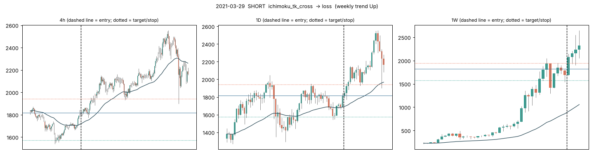
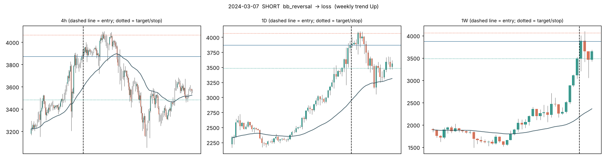
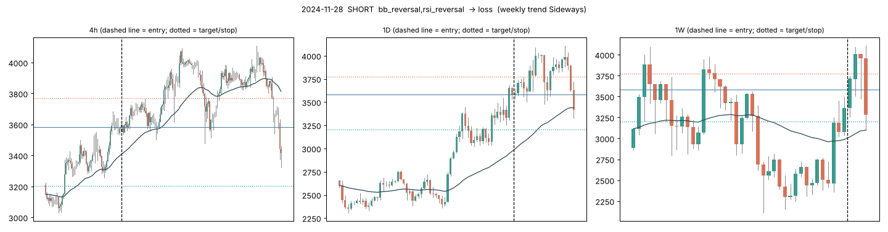
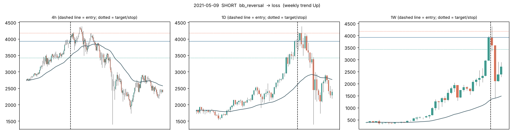
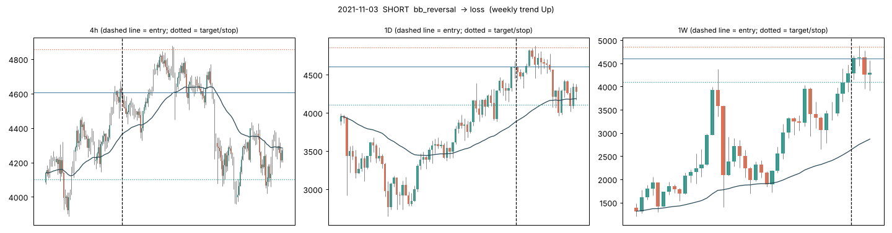
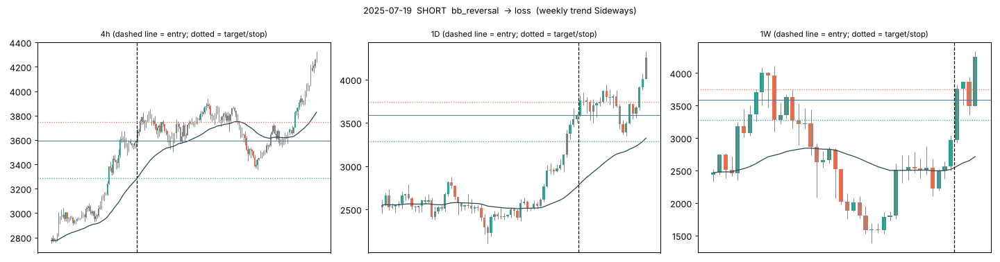
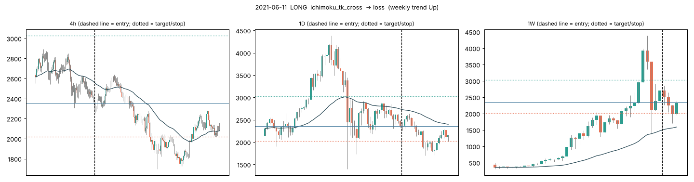
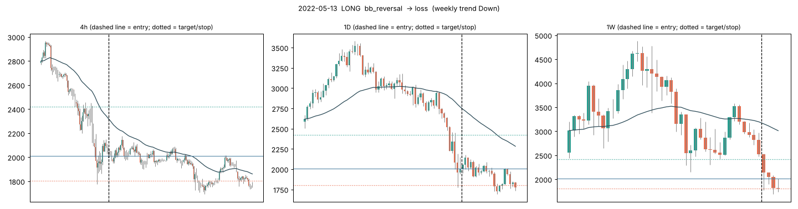

# Failure analysis - why did trades fail?

Trades = the signal-study entries (next-day open, +2 ATR target, -1 ATR stop, 20 days). Signals that fired on the same day in the same direction are counted as **one** trade.

## 1. How many failed

**637 of 1006 trades failed (63%)**, 317 won, 52 timed out. With a 2:1 target the break-even fail rate is about 67%.

| year | failed | won | timeout | fail rate |
|---|---|---|---|---|
| 2019 | 2 | 0 | 0 | 100% |
| 2020 | 95 | 54 | 7 | 61% |
| 2021 | 100 | 37 | 14 | 66% |
| 2022 | 88 | 45 | 10 | 62% |
| 2023 | 84 | 49 | 11 | 58% |
| 2024 | 110 | 48 | 3 | 68% |
| 2025 | 94 | 49 | 5 | 64% |
| 2026 | 64 | 35 | 2 | 63% |

How the failures happened (research period, 553 failures):
- **41% failed within 2 days** of entry: the move against us started almost immediately.
- **19% were right first**: price went at least +1 ATR our way before turning and hitting the stop.

## 2. Were the other timeframes pointing the other way?

For each trade: on how many of the 10 timeframes (15m ... 1W) was price on the **wrong side of its EMA50**?

| timeframes against | trades | fail rate | win rate | avg R |
|---|---|---|---|---|
| 0 | 219 | 62% | 34% | +0.07 |
| 1 | 187 | 64% | 31% | -0.01 |
| 2 | 91 | 62% | 32% | +0.06 |
| 3 | 66 | 65% | 27% | -0.05 |
| 4 | 44 | 59% | 32% | +0.08 |
| 5 | 40 | 57% | 35% | +0.16 |
| 6 | 67 | 58% | 36% | +0.14 |
| 7 | 70 | 67% | 26% | -0.15 |
| 8 | 34 | 68% | 29% | -0.05 |
| 9 | 37 | 62% | 32% | +0.08 |
| 10 | 23 | 78% | 22% | -0.35 |

All 90 hints together (9 hints x 10 timeframes), trades grouped by how many warned against them:

| warnings against the trade | trades | fail rate | avg R |
|---|---|---|---|
| 3-13 | 226 | 58% | +0.11 |
| 14-19 | 225 | 66% | -0.03 |
| 20-25 | 233 | 58% | +0.15 |
| 26-38 | 194 | 71% | -0.16 |

## 3. Which warnings came before failures?

Each row: when this hint pointed **against** the trade, how often did it fail, vs when it didn't? Research period, warnings present in at least 30 trades. **Holdout** columns are later, unseen data: a warning is only believable if it also shows up there.

| TF | hint | trades warned | fail if warned | fail if not | R if warned | R if not | holdout n | holdout fail if warned | holdout fail if not |
|---|---|---|---|---|---|---|---|---|---|
| 1W | macd_fade | 131 | 73% | 61% | -0.24 | +0.07 | 20 | 80% | 63% |
| 1W | stretch | 56 | 71% | 62% | -0.14 | +0.03 | 0 | - | 66% |
| 15m | rsi_ext | 84 | 70% | 62% | -0.22 | +0.05 | 12 | 67% | 66% |
| 30m | cloud | 102 | 70% | 62% | -0.22 | +0.05 | 9 | 56% | 67% |
| 12h | macd_fade | 77 | 69% | 62% | -0.24 | +0.05 | 11 | 45% | 68% |
| 1h | cloud | 125 | 69% | 62% | -0.16 | +0.05 | 14 | 71% | 65% |
| 15m | bb_ext | 80 | 69% | 62% | -0.08 | +0.03 | 8 | 50% | 67% |
| 1W | bb_ext | 41 | 68% | 63% | -0.08 | +0.03 | 0 | - | 66% |
| 1W | rsi_ext | 47 | 68% | 63% | -0.04 | +0.03 | 0 | - | 66% |
| 2h | cloud | 204 | 68% | 62% | -0.12 | +0.07 | 19 | 68% | 65% |
| 6h | macd | 219 | 67% | 62% | -0.11 | +0.07 | 25 | 60% | 67% |
| 1D | cloud | 337 | 67% | 61% | -0.10 | +0.10 | 45 | 71% | 63% |
| 4h | slope | 214 | 66% | 62% | -0.06 | +0.05 | 24 | 79% | 63% |
| 8h | cloud | 291 | 66% | 61% | -0.08 | +0.07 | 45 | 71% | 63% |
| 12h | trend | 319 | 66% | 61% | -0.06 | +0.07 | 44 | 68% | 65% |
| 30m | stretch | 127 | 66% | 62% | -0.07 | +0.04 | 19 | 74% | 64% |
| 12h | rsi_ext | 115 | 66% | 63% | +0.00 | +0.03 | 21 | 57% | 68% |
| 4h | bb_ext | 194 | 66% | 62% | -0.03 | +0.04 | 29 | 69% | 65% |
| 8h | stretch | 191 | 66% | 62% | -0.01 | +0.03 | 28 | 54% | 69% |
| 6h | rsi_ext | 188 | 66% | 62% | -0.01 | +0.03 | 26 | 46% | 71% |

Hint meanings: **trend** close vs EMA50 · **slope** EMA20 direction · **macd** histogram sign · **macd_fade** histogram shrinking 2 candles · **rsi_ext** RSI >70 (long) / <30 (short) · **cloud** Ichimoku cloud side · **bb_ext** close outside Bollinger band · **stretch** >2 ATR from EMA20 · **diverge** price at 20-candle extreme while RSI isn't.

With 90 hints tested, a few will look meaningful by chance. Trust a hint only if the holdout agrees.

## 4. Reality check: 20% per week at 5x

- 20% a week compounds to **13,105x per year**.
- At 5x you need ETH to move **4.0%** your way *every week*, after costs.
- Weeks where ETH's open-to-close move was that big (either direction): **62%** of 359 weeks. Median weekly move: 6.1%.
- Even with perfect hindsight, picking the best point in each week: **96%** of weeks.
- So even a trader who always knew the direction would miss the target in many weeks. A strategy that needs 20% *every* week has to risk liquidation to chase it.

## 5. Example failed trades (most warnings ignored)

Raw data with every hint per trade: `trades_with_hints.csv`.
